# Galeria de prévias

Pranchas originais; não são sprites ou capturas de jogo funcionando. Consulte o inventário antes de integrar.

## felipe/carro-traseira

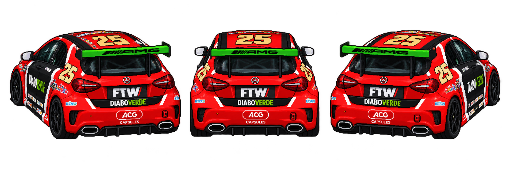

## felipe/retrato-e-corpo

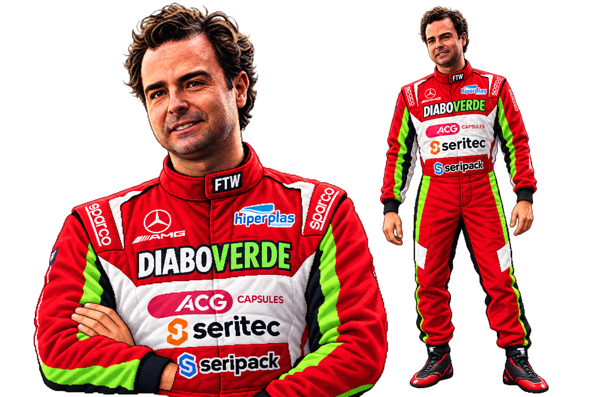

## arquivo/felipe-tentativa-recorte

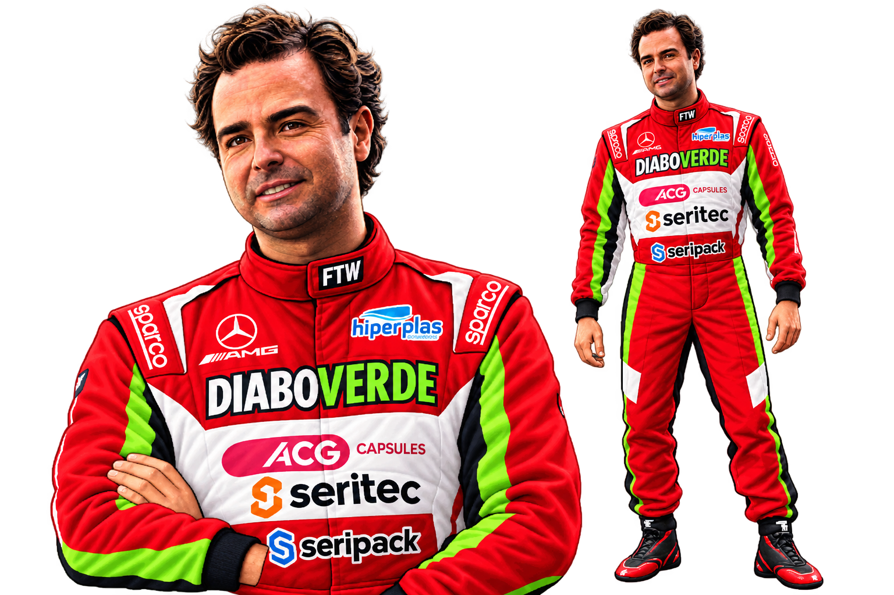

## felipe/piloto-com-e-sem-capacete

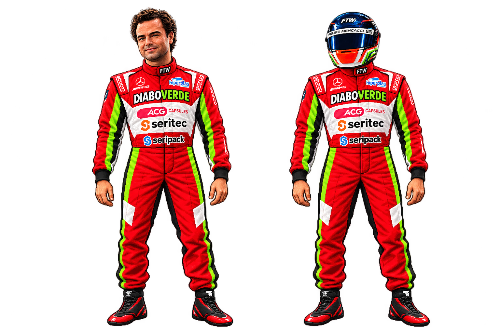

## felipe/carro-frente

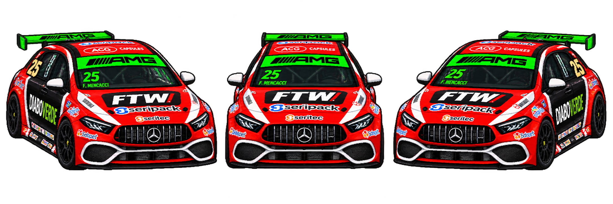

## arquivo/felipe-variante-curvas

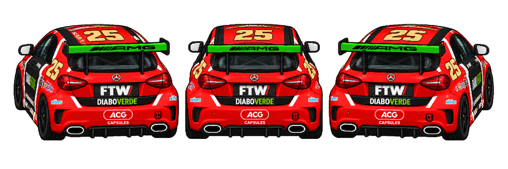

## daniel/carro-traseira

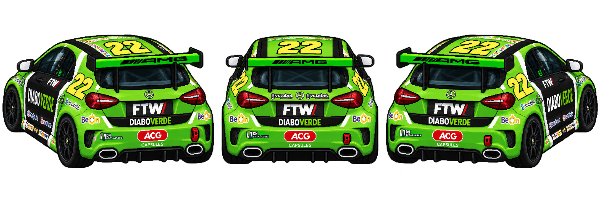

## daniel/piloto-com-e-sem-capacete

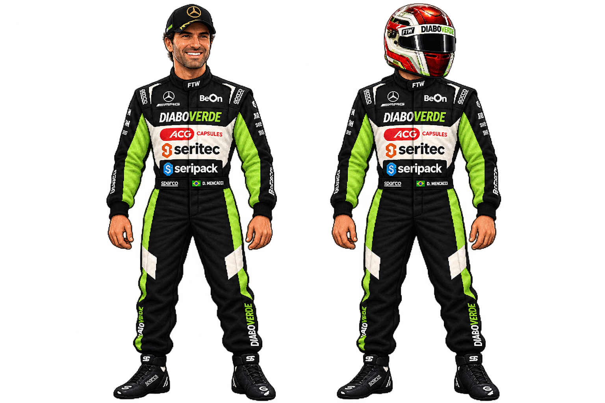

## daniel/carro-frente

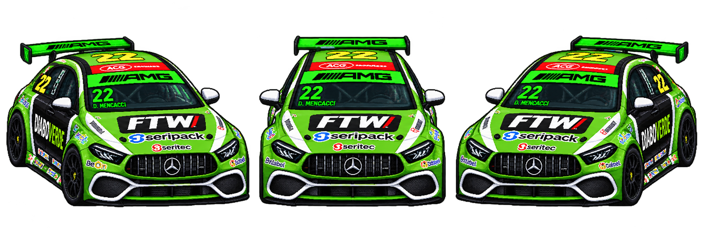

## arquivo/daniel-variante-curvas

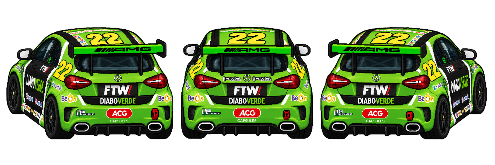

## cascavel/reta-principal

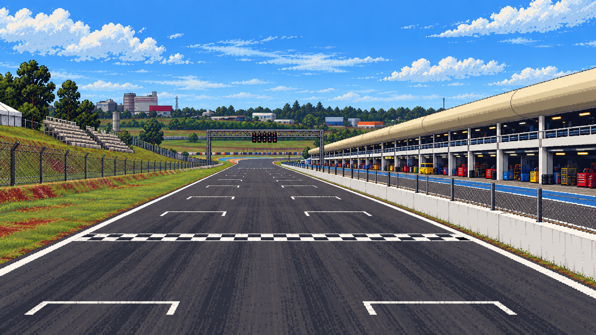

## cascavel/curvas-e-mata

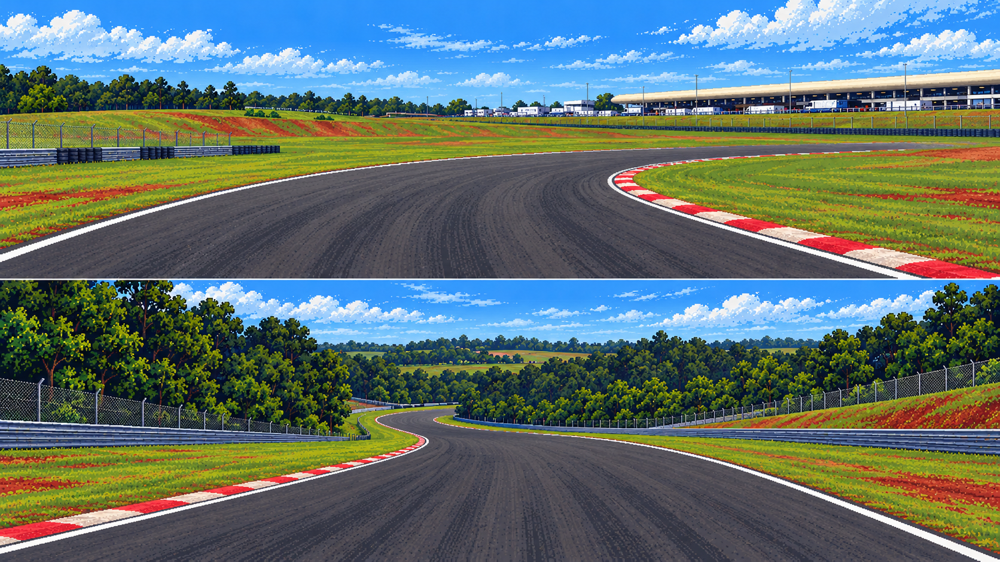

## cascavel/vegetacao-e-barreiras

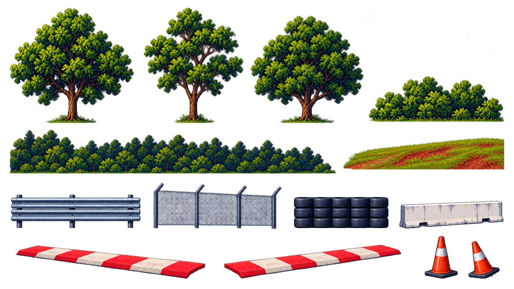

## cascavel/boxes-e-sinalizacao

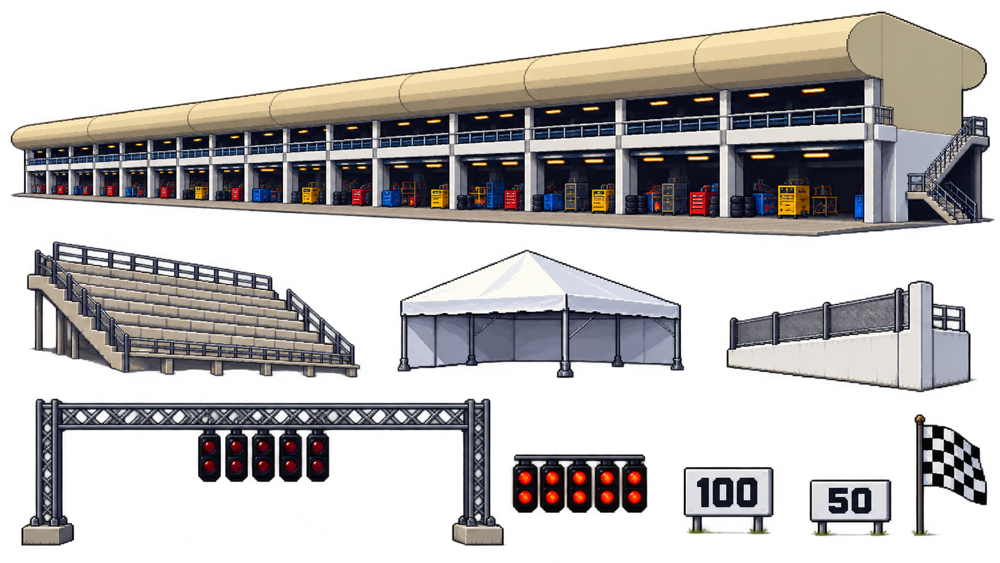

## fx/estudo-fumaca-poeira-nitro-impacto

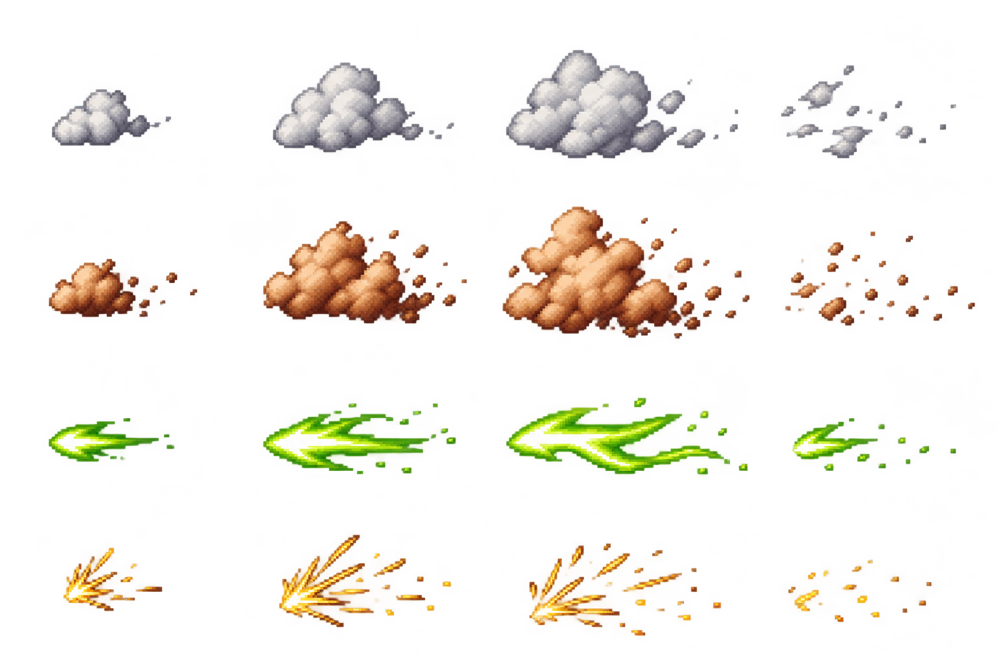

## ui/proposta-selecao-e-hud

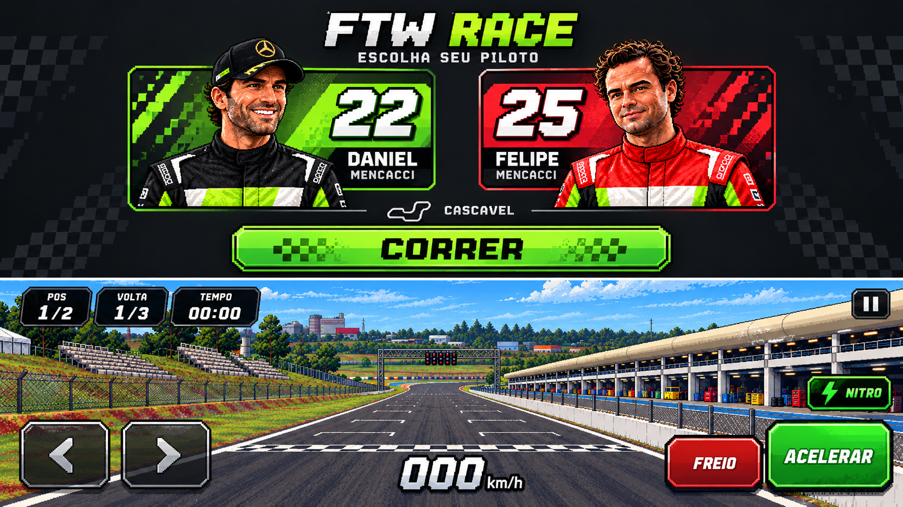

